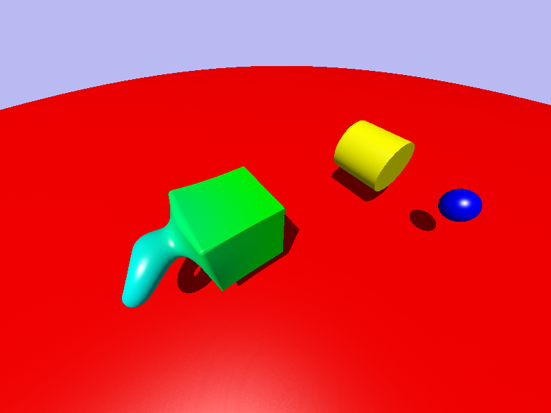

# OpenGL ray marcher
## Ray marcher written in C, SDL, and OpenGL 3.3



## Try it out

Try it out on the web [here](https://duckdood.github.io/terra/raymarcher), or get a GNU/Linux release [here](https://github.com/DuckDood/raymarcher/releases/tag/release).

## Building locally (Tested with GCC on GNU/Linux)

You need SDL3 headers.
```
git clone https://github.com/DuckDood/raymarcher.git
cd raymarcher
make
```

This should create a binary in the build/ directory.

## Credits
[Inigo Quilez](https://iquilezles.org/)'s website has a bunch of stuff relating to raymarching, such as smooth functions and distance functions for a ton of primitives, and [Sebastian Lague](https://www.youtube.com/watch?v=Cp5WWtMoeKg)'s raymarching video for an overview on the technique. I also used [LearnOpenGL](https://learnopengl.com/) for some quick reminders about some OpenGL functions and Blinn-Phong lighting, though I didn't really follow the tutorial as I have used OpenGL before.

## Technical Info
This is a raymarcher that uses a signed distance field (SDF) to march along a ray's path until it collides with something. This allows you to really easily create boolean operations on shapes, and even use smooth versions of them as well. This also uses a system I created that lets you define combinations of objects as data, rather than hardcoding how objects should combine. It also creates shadows by sending a ray in the direction of the sun from the hit point of an object.

## AI use
I only used AI a little bit for diagnosing performance issues when compiling to WebGL with the Emscripten build, and I might've (but I tried not to) get information from the AI overview on Google searches.
